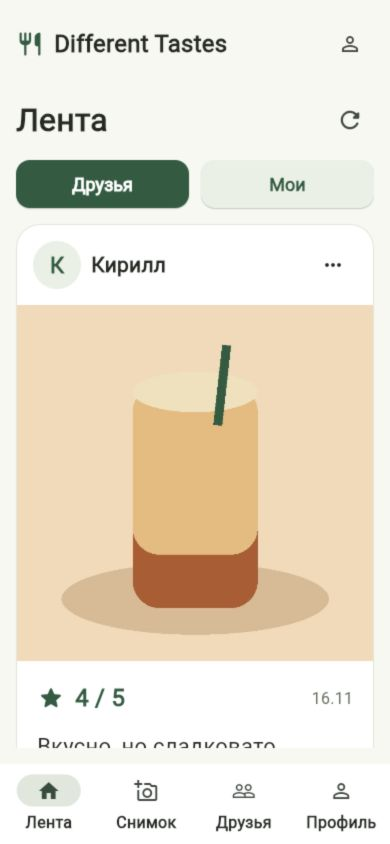

# Different Tastes

Share your tastes with your friends.

Веб-приложение для фотографий еды и напитков, коротких отзывов и оценок. Лента доступна только автору и его принятым друзьям.



## Возможности

- Единый вход по нику и паролю: новый ник создаёт аккаунт автоматически; существующий требует правильного пароля. Сессия сохраняется на 7 дней.
- Поиск по нику, заявки в друзья, принятие, отклонение и отмена заявок.
- Лента друзей и отдельный фильтр своих публикаций, загрузка постов порциями.
- Стабильная квадратная рамка камеры и снимка, переключение передней и задней камеры.
- Снимок с камеры или фотография из галереи: JPG, PNG, WebP, HEIC/HEIF до 8 МБ.
- Оценка от 1 до 5 и необязательный отзыв до 30 символов.
- Редактирование своих постов и удаление с подтверждением.
- Профиль, аватарка из галереи, счётчики публикаций и друзей. Аватарки видны в ленте и списке друзей.
- Мобильная навигация и боковое меню на широком экране.
- Компактный переключатель пяти тем со смайликами рядом с названием. Выбор сохраняется в браузере.

## Быстрый запуск

Нужен Python 3.12 или новее. Команды выполняются из корня репозитория.

```bash
python3 -m venv .venv
source .venv/bin/activate
python -m pip install -r requirements.txt
python 1vDT/main.py
```

На Windows активация: `.venv\Scripts\activate`.

Открой **http://127.0.0.1:8550**. Порт постоянный, поэтому сохранённый вход работает и после перезапуска сервера.

Ник и пароль не должны быть пустыми; ограничений длины и набора символов в форме нет. Регистр ника не учитывается, пробелы по краям ника убираются. В ленте и поиске используется ник. Таблица `users` содержит только `id`, `username` и `password_hash`. Путь к аватарке хранится отдельно в `profiles`, изображения — в `data/avatars/`. При первом запуске старая таблица обновляется автоматически; перед этим создаётся локальная резервная копия в `data/backups/`. Опечатка в свободном нике создаст новый аккаунт.

Если камера недоступна, используй галерею. Для камеры на телефоне нужен HTTPS; `localhost` разрешён при локальной разработке. Фотографии HEIC/HEIF с iPhone поддерживаются и преобразуются в JPEG. Галерея открывается непосредственно на устройстве через клиентское действие `PickFiles`, что требуется Safari на iOS.

## Данные и приватность

По умолчанию SQLite и фотографии находятся в `1vDT/data/`. База создаётся при первом запуске; существующая структура обновляется автоматически. Новые пути к фотографиям относительные, старые публикации поддерживаются.

- Пароли хешируются Argon2; исходные пароли не записываются.
- В базе хранятся только SHA-256-хеши случайных токенов сессии.
- Выход отзывает сессию. Другие вкладки с этим токеном запросят вход при следующем действии.
- После пяти неверных попыток входа логин блокируется на пять минут.
- У новых изображений удаляются метаданные, учитывается поворот EXIF, размер уменьшается до 1600 пикселей.
- База, фотографии, виртуальное окружение и локальные настройки исключены из Git и Docker-образа.

Сохраняй резервную копию всей папки данных при остановленном приложении. Локальные данные не загружаются на GitHub. Старые посты без автора не присваиваются новому аккаунту автоматически.

## Настройки

Переменные окружения:

| Переменная | По умолчанию | Назначение |
|---|---|---|
| `DT_DATA_DIR` | `1vDT/data` | Папка SQLite и фотографий |
| `DT_HOST` | `127.0.0.1` | Адрес сервера |
| `PORT` | `8550` | Порт |
| `DT_HEADLESS` | `0` | `1`: запуск без открытия браузера |

Пример серверного запуска:

```bash
DT_HEADLESS=1 DT_HOST=0.0.0.0 PORT=8550 python 1vDT/main.py
```

Папку данных размещай на постоянном диске. При публикации используй HTTPS и прокси с поддержкой WebSocket. Все друзья подключаются к одному серверу; отдельные запуски с разными базами не обмениваются постами. Одного процесса приложения достаточно для первой небольшой группы пользователей.

## Docker

```bash
docker compose up --build -d
```

Открой **http://127.0.0.1:8550**. Данные сохраняются в именованном томе `tastes-data`, приложение запускается от непривилегированного пользователя. Compose публикует порт только на локальном интерфейсе; для публичного доступа подключи HTTPS-прокси.

## Проверки

```bash
python -m unittest discover -s tests -v
```

Тесты работают с отдельными временными базами и проверяют права доступа, заявки, постраничную ленту, обработку фото, сохранение публикаций, сессии, смену пароля и восстановление после ошибок. GitHub Actions запускает их на Python 3.12 и 3.14.

## Структура

```text
1vDT/
  main.py          интерфейс и сценарии приложения
  auth.py          пароли, вход и сессии
  auth_ui.py       единая форма входа
  themes.py        пять палитр и переключатель со смайликами
  database.py      запросы и обновление структуры SQLite
  friends_ui.py    поиск, друзья и заявки
  media.py         проверка, обработка и хранение фотографий
  ui.py            общие стили и элементы интерфейса
  data/            локальные данные, исключены из Git
```

Это готовая первая веб-версия. Нативное iOS-приложение, WidgetKit-виджет, push-уведомления и восстановление пароля по почте пока не реализованы. Сайт можно добавить на домашний экран iPhone; живой виджет требует отдельного iOS-расширения.
